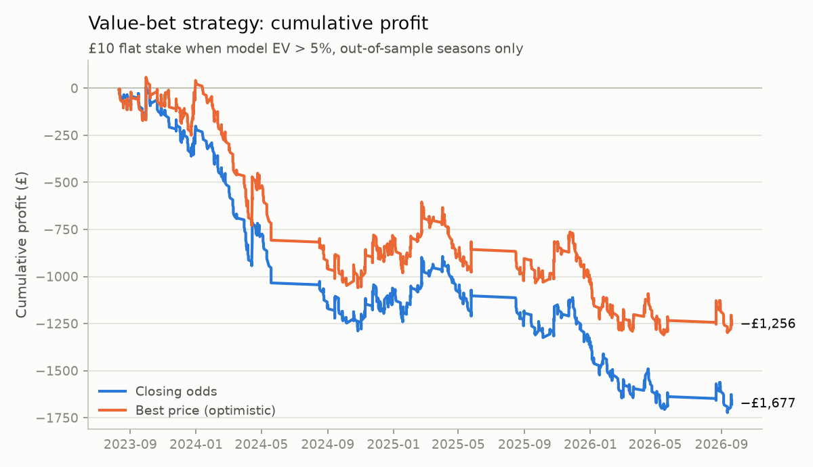
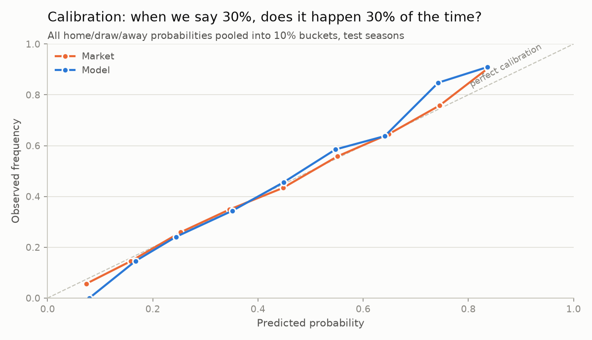
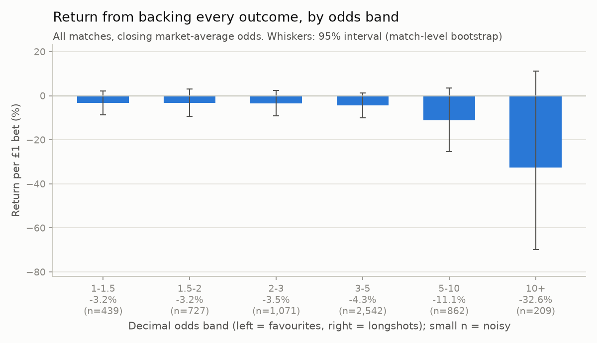

# Do Premier League betting markets price risk efficiently?

A football betting market is a market for risk: every price is a probability with a
margin added on top. This project asks whether those prices are accurate, and whether
a statistical model can find outcomes the market misprices.

I strip the bookmaker's margin out of the closing odds to get the market's implied
probabilities, build an independent Poisson goals model, and compare the two
out of sample on accuracy and on a simulated betting strategy.

## Results

**Short answer: the market priced risk well, and a model built only on past goals could not beat it.
The model's "value bets" lost 17.5%, far more than the 4.7% bookmaker margin, because the model
systematically underrated favourites, so it kept backing underdogs the market had priced correctly.**

Test set: 1,190 matches (2023-24 to the first 50 matches of 2026-27), none used for tuning.

| Forecast | Brier | Log loss | RPS |
|---|---|---|---|
| Model (Poisson) | 0.592 | 0.993 | 0.203 |
| Market (closing, margin removed) | 0.573 | 0.964 | 0.194 |
| Base rates only (no information) | 0.651 | 1.076 | 0.232 |

* **Accuracy.** The market beat the model on every metric. Model minus market log loss is +0.030
  (95% CI +0.018 to +0.041), so the gap is not noise. A blend of the two, weighted on the validation
  season, put **0%** weight on the model: it added nothing the market didn't already know.
* **Betting strategy (rule fixed in advance).** 960 bets, ROI **−17.5%** (95% CI −28.9% to −5.0%),
  maximum drawdown £1,729. It held at Pinnacle's sharper odds too: −15.8% (95% CI −28.5% to −2.7%).
* **Why it lost.** The model's probabilities are too compressed. Its home-win probabilities have a
  standard deviation of 0.145 against the market's 0.190, and its calibration slope is 1.29 against
  the market's 1.10, where 1 is perfect. It gave favourites 49.4% on average; the market said 54.0%
  and they won 54.6%. On the bets it placed, the model said 31.5%, the market said 24.7%, and they
  won 20.5%. Every disagreement was the model's error, not a market mispricing: a winner's-curse
  effect, where selecting on your biggest disagreements selects your biggest mistakes.
* **Pricing of risk.** Backing every outcome loses about 3–4% on odds below 5 but 11% on odds of
  5–10 and 33% on odds of 10 or more, which is the shape of the favourite-longshot bias. **It is not
  statistically significant here**: the longshot-minus-favourite gap is −12.1% (95% CI −27.9% to
  +4.2%). It is a pattern worth testing on more data, not a finding.
* **Market average vs Pinnacle.** On the 970 test matches with Pinnacle odds, the market-average
  price (log loss 0.9445) was as accurate as Pinnacle's (0.9448), despite a margin of 4.7% vs 3.0%.





## Method

**Data.** 1,950 Premier League matches, 2021-22 to September 2026, from
[football-data.co.uk](https://www.football-data.co.uk/englandm.php). The market price is the
**market-average closing odds**, available for every match. Pinnacle's closing odds (the
sharpest book) stop partway through 2025-26 in this data, so using them as the main benchmark
would have switched benchmark mid-test. Pinnacle is reported as a robustness check instead.
This choice was made before any results on real data were seen.

**Split.** 2021-22 is burn-in (training only). 2022-23 is validation, used only to choose the
model's two hyperparameters, by log loss rather than profit. 2023-24 onwards is the test set,
and every headline number comes from it.

**Market probabilities.** Implied probability = 1 / decimal odds. These sum to more than
100%; the excess is the overround. I normalise proportionally, and check the result with
the power method, which loads more margin onto longshots.

**Model.** Each team has attack and defence ratings. Expected goals are
`exp(mu + home_adv + attack[home] − defence[away])`, and the same without home advantage
for the away side. Goals are Poisson, which gives home/draw/away probabilities. Ratings
are fitted by maximum likelihood with:
* exponential time decay, so recent matches count more;
* a ridge penalty towards a prior, so thin data doesn't produce extreme ratings;
* a prior for promoted teams equal to the average of the teams they replaced.

**No look-ahead.** The model is refitted before every match date using only earlier
matches. `tests/test_no_lookahead` scrambles all future results and confirms that
earlier predictions don't change.

**Betting rule.** If the model's expected value `p × odds − 1` exceeds 5% on any outcome,
stake £10 on the best one, at the closing odds. The threshold was set before testing.
Other thresholds are reported only for transparency.

**Evaluation.** Brier score, log loss and RPS; a paired bootstrap on the model-minus-market
log loss; calibration curves; a forecast-encompassing blend weight; and bootstrap
confidence intervals and maximum drawdown for the strategy.

## Disclosures

* The time-decay grid was widened (0.0075 and 0.01 added) after the first full run, because the
  best validation value sat on the edge of the original grid. That first run's test results had
  been printed. Selection still used validation log loss only, and the improvement was tiny
  (0.9843 to 0.9839). With the original grid, the strategy's ROI was −14.7% (95% CI −26.3% to
  −2.5%); the conclusion does not change.
* The diagnosis in "Why it lost" was added after seeing the strategy lose. It explains the result
  and was not used to choose anything.

## Limitations

* Independent Poisson underestimates draws a little; Dixon–Coles adds a correction.
* The model only sees goals, with no injuries, lineups, xG or transfers. The market sees all of these.
* About 1,190 test matches and 960 bets, so ROI intervals are wide (±12 points).
* The model's probabilities are too compressed. Recalibrating them on the validation season (stretching by the slope) is the obvious next step, and it must be fitted on validation, not test.
* Betting at closing odds assumes you can get that price just before kick-off, with no stake limits.

## Run it

```
pip install -r requirements.txt
python -m pytest -q          # 7 tests, including the look-ahead test
python run_all.py            # reads data/raw, writes outputs/
```

To check the pipeline without real data:
`python scripts/make_synthetic_data.py` then `python run_all.py --data data/synthetic --out outputs_synth`.

## Project layout

```
config.py            every betting/model choice, fixed up front
run_all.py           the whole pipeline, stage by stage
epl/data.py          stage 1  load and clean the CSVs
epl/odds.py          stage 2  odds -> probabilities, margin removal
epl/model.py         stage 3  Poisson ratings model
epl/walkforward.py   stage 3  leak-free refitting before each match date
epl/evaluate.py      stage 4  Brier, log loss, RPS, calibration, bootstrap
epl/backtest.py      stage 4  value-bet simulation, ROI, drawdown, longshot bias
epl/plots.py         charts
tests/test_core.py   unit tests, including no look-ahead
```
